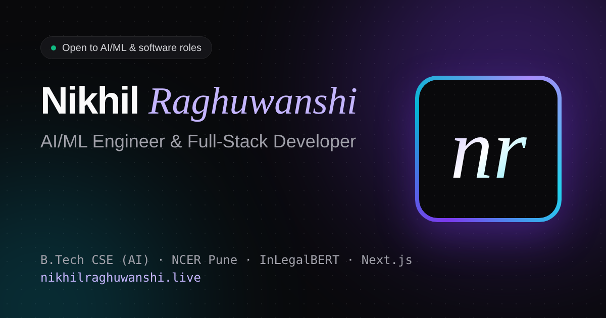

# Nikhil Raghuwanshi · Portfolio

Personal portfolio of **Nikhil Raghuwanshi**, a B.Tech Computer Science & Engineering (Artificial Intelligence) student at Nutan College of Engineering and Research, Pune, building AI/ML and full-stack projects.

🔗 **Live:** https://nikhilraghuwanshi.live



## Tech stack

| Layer | Tool |
|---|---|
| Framework | [React 18](https://react.dev) |
| Build tool | [Vite 5](https://vitejs.dev) |
| Styling | [Tailwind CSS 4](https://tailwindcss.com) |
| Animation | [Framer Motion 11](https://www.framer.com/motion/) |
| Icons | [React Icons](https://react-icons.github.io/react-icons/) (Lucide + Simple Icons) |
| Fonts | Geist, Geist Mono, Instrument Serif (Google Fonts) |
| Hosting | GitHub Pages via GitHub Actions |

## Features

- Intro loader, staggered hero text and a typewriter that cycles through roles
- Scroll-reveal animations, a scroll progress bar and a cursor-following glow
- 3D tilt cards with a spotlight hover effect
- Project filter tabs with animated layout changes
- Pop-up project case studies with animated charts and pipelines (Esc or click outside to close)
- A timeline that draws itself as you scroll
- An infinite skills marquee and counters that animate up
- Magnetic buttons, toast notifications and copy-to-clipboard email
- A FAQ chatbot (bottom right) that answers common questions about me, running fully in the browser with no API key
- Live demo and source code buttons on every project
- Light and dark mode that remembers your choice
- Fully responsive, keyboard accessible and respects "reduce motion"

## Project structure

```
My-Portfolio/
├── .github/workflows/deploy.yml   # builds & deploys to GitHub Pages on every push to main
├── public/
│   ├── favicon.svg, og-image.png, CNAME   # CNAME = custom domain
│   └── certificates/              # certificate PDFs (+ img/ previews used in the pop-up)
├── src/
│   ├── data/
│   │   ├── portfolio.js           # ← ALL content lives here (edit this to update the site)
│   │   └── chatbot.js             # chatbot questions, keywords and answers
│   ├── hooks/
│   │   ├── useTheme.js            # light/dark mode
│   │   └── useActiveSection.js    # highlights the current nav link
│   ├── components/
│   │   ├── Loader.jsx             # intro screen
│   │   ├── Navbar.jsx             # sticky glass nav, theme toggle, mobile menu
│   │   ├── Hero.jsx               # headline, typewriter, notebook card
│   │   ├── About.jsx              # bio + animated counters
│   │   ├── Projects.jsx           # filterable project cards
│   │   ├── ProjectModal.jsx       # project case-study pop-up
│   │   ├── Experience.jsx         # scroll-drawn timeline
│   │   ├── Skills.jsx             # marquee + skill groups
│   │   ├── Education.jsx          # education
│   │   ├── Certifications.jsx     # filterable certificate grid
│   │   ├── CertificateModal.jsx   # certificate preview pop-up
│   │   ├── Contact.jsx            # contact cards, coding profiles + message form
│   │   ├── ChatBot.jsx            # floating FAQ assistant
│   │   ├── Footer.jsx, BackToTop.jsx
│   │   ├── Avatar.jsx             # photo, or animated "nr" monogram when no photo is set
│   │   └── (shared) Reveal, SectionHeading, TiltCard, Magnetic, Counter,
│   │       Typewriter, Toast, Icon, ScrollProgress, CursorGlow
│   ├── App.jsx
│   ├── main.jsx
│   └── index.css                  # Tailwind theme, keyframes, utilities
├── seo.config.js                  # build-time SEO (meta tags, structured data, crawlable HTML)
├── index.html
├── vite.config.js
└── package.json
```

## SEO

`seo.config.js` runs at build time and writes into `index.html`: the page title and description, Open Graph/Twitter preview tags, `Person` + `WebSite` structured data (JSON-LD), and a plain-HTML text version of the whole page for search engines. `public/` also has `robots.txt`, `sitemap.xml`, `og-image.png` and app icons. Content comes from `src/data/portfolio.js`, so SEO updates itself when you edit that file.

## Run locally

```bash
npm install
npm run dev       # http://localhost:5173
npm run build     # production build in dist/
```

## Deploy

1. Push to `main`.
2. In the repo, go to **Settings → Pages → Build and deployment → Source** and choose **GitHub Actions** (one-time setup).
3. The workflow builds and publishes the site automatically on every push.

### Custom domain (nikhilraghuwanshi.live)

Registered free for one year at Name.com through the GitHub Student Developer Pack.

1. In Name.com → **My Domains → nikhilraghuwanshi.live → Manage DNS Records**, delete any default/parking records, then add:
   - four **A** records with an empty host: `185.199.108.153`, `185.199.109.153`, `185.199.110.153`, `185.199.111.153`
   - one **CNAME** record with host `www` → `nikhil270703.github.io`
2. In the repo → **Settings → Pages → Custom domain**, enter `nikhilraghuwanshi.live` and save.
3. Once the DNS check passes (minutes to a few hours), tick **Enforce HTTPS**.
4. The free year ends Nov 2027: turn off auto-renew in Name.com if you don't want to be charged.

## Updating content

Edit `src/data/portfolio.js`. To add a resume button, paste a public PDF link into `profile.resume`.

**Adding a photo:** put `nikhil-raghuwanshi.jpg` (square, ~460 px) and `nikhil-raghuwanshi-sm.jpg` (~96 px) in `public/`, then set `profile.photo` and `profile.photoSmall` to those names. Until then the site shows an animated "nr" monogram.

**Adding a certificate:** put the PDF in `public/certificates/<name>.pdf`, create a preview with
`pdftoppm -jpeg -scale-to-x 1400 -scale-to-y -1 -singlefile public/certificates/<name>.pdf public/certificates/img/<name>`,
then add an entry to `certifications` with `file: '<name>'`.
